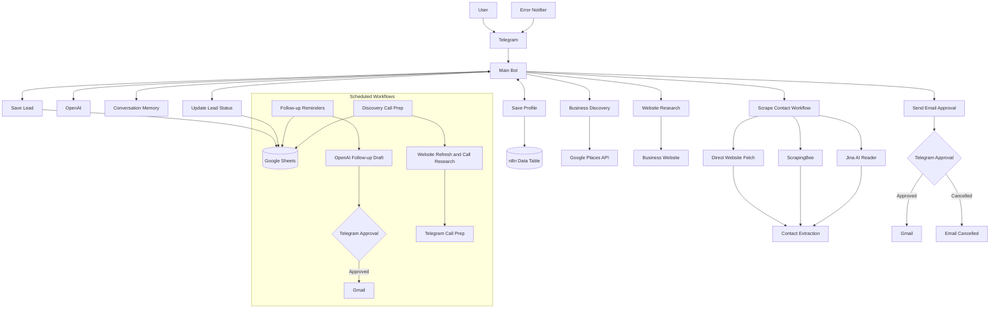

# n8n AI Prospecting Assistant

An AI-powered Telegram prospecting assistant built with n8n. It helps freelancers find potential clients, research businesses, collect contact information, and prepare personalized outreach emails. **Every email requires your approval in Telegram before it is sent through Gmail.**

## Demo

[Watch the project demo](https://youtube.com/shorts/S9Vl1jGersU?feature=share)

## What It Does

The assistant provides a Telegram interface for prospecting and managing potential clients.

You can search for local businesses by niche and location, research their websites, find publicly available contact details, and generate personalized outreach drafts using your saved freelancer profile.

Prospects can be saved to Google Sheets and tracked through follow-ups. Emails are never sent automatically: the assistant requests your approval in Telegram before sending them through Gmail.

## How It Works

1. **Set up your profile:** The assistant collects your name, profession, services, ideal clients, unique selling point, and preferred outreach tone.
2. **Find potential clients:** Search for businesses by niche and location using Google Places.
3. **Research businesses:** The assistant reads business websites and gathers information to help personalize outreach.
4. **Find contact details:** The contact extraction workflow checks website content for publicly available emails, phone numbers, and social links.
5. **Prepare outreach:** OpenAI generates personalized email drafts based on your profile and the business research.
6. **Approve emails:** Review the draft in Telegram and approve or cancel it before Gmail sends anything.
7. **Manage prospects:** Save businesses to Google Sheets, update their status, and receive scheduled follow-up reminders.
8. **Prepare for calls:** Receive research notes and suggested questions before scheduled discovery calls.

## Architecture

The system consists of a central Telegram assistant, supporting n8n workflows, external services, and two scheduled automations.

## Included Workflows

The repository contains nine n8n workflow JSON files:

| **Workflow** | **What it does** |
|---|---|
| **Main Bot** | Receives Telegram messages, manages conversation context, and coordinates the assistant's tools. |
| **Save Profile** | Stores or updates the freelancer's profile in an n8n Data Table. |
| **Save Lead** | Adds prospect information and follow-up fields to Google Sheets. |
| **Scrape Contact** | Retrieves website content and extracts publicly available contact information. |
| **Send Email Approval** | Requests approval in Telegram before sending an email through Gmail. |
| **Update Lead Status** | Updates a saved prospect's status in Google Sheets. |
| **Follow-up Reminders** | Checks prospects daily, prepares follow-up drafts, and requests approval before sending. |
| **Discovery Call Prep** | Checks upcoming calls, refreshes website information, and sends preparation notes through Telegram. |
| **Error Notifier** | Sends Telegram alerts when a configured workflow encounters an error. |

Business discovery and homepage fetching are built-in tools in Main Bot rather than separate imported workflow files.

## Who Is This For?

Primarily freelancers who want to simplify finding and managing potential clients. It can also be adapted by consultants, small agencies, and independent professionals handling their own outreach. It works best for finding local businesses.

## Requirements

You will need your own accounts and credentials for:

- n8n (cloud or self-hosted)
- Telegram Bot
- OpenAI API
- Google Cloud with Places API enabled
- Google Sheets
- Gmail
- ScrapingBee
- Jina AI Reader

**Running n8n:** You can use n8n Cloud or self-host n8n using its free Community Edition. Self-hosting avoids an n8n Cloud subscription, but you may still have hosting and infrastructure costs.

**Costs:** Google Places API, OpenAI, ScrapingBee, and other connected services may have usage-based charges. Actual costs depend on your usage and the providers' pricing. Check their current pricing before running the workflows.

## Setup

1. Clone or download this repository.
2. Import all nine workflow JSON files into your n8n instance.
3. Configure the required credentials and services.
4. Reconnect the five sub-workflows used by Main Bot after importing, because n8n assigns new workflow IDs.
5. Configure the scheduled workflows and Telegram notification settings.
6. Test the workflows before activating them.

For detailed installation steps, credential configuration, workflow connections, and known limitations, see the [AI Workflow Setup Guide](docs/AI%20Workflow%20Setup%20Guide%20.pdf).

## License

This project is licensed under the MIT License. See the [LICENSE](LICENSE) file for details.
